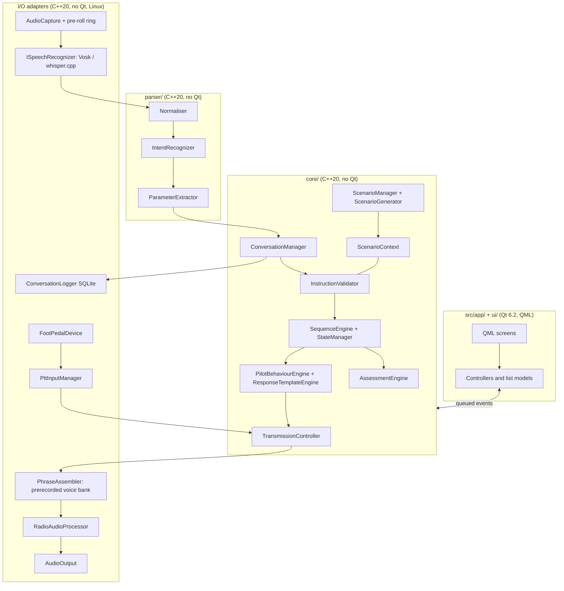
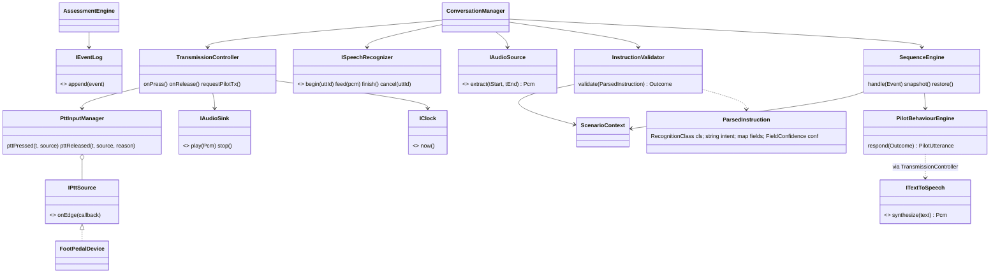

# 01 System architecture

## 1. Layers



Dependency rule: `app → adapters → parser → core types`. `core` depends only on the C++ standard library and nlohmann-json (loading). Adapters implement interfaces declared in `core`.

## 2. Threads

| Thread | Runs | Rules |
|---|---|---|
| GUI (Qt) | QML, controllers | No file, audio, STT, voice or DB work |
| Core | One event queue: TransmissionController, SequenceEngine, pilot, assessment | Single-threaded, injected clock and RNG, no blocking I/O |
| Pedal | libevdev + libudev `poll()` | Timestamps in CLOCK_MONOTONIC, posts to core |
| Capture | PulseAudio callback | Writes ring buffer only; no allocation, no locks |
| STT worker | Streaming feed / batch decode | One utterance at a time; cancellable |
| Voice worker | Clip assembly + DSP | Produces one PCM buffer before playback starts |
| Playback | PulseAudio callback | Checks atomic `mute` each block (interrupt policy) |
| DB writer | SQLite | Bounded queue, batched transactions; overflow is logged and raises a UI fault |

The app bridges core events to Qt with queued signals. Level meter capped at 25 Hz.

## 3. Module responsibility matrix

| Module | Responsibility | Depends on | Qt | Tested without hardware by |
|---|---|---|---|---|
| ScenarioManager | Load, schema and semantic validation | JSON | No | Good and bad files |
| ScenarioGenerator | Seeded, mutually valid parameters | pools | No | Property tests over many seeds |
| ScenarioContext | Parameters, clearances, readbacks, history | – | No | Unit |
| SequenceEngine / StateManager | Data-driven FSM, timers, snapshot/restore | Context | No | Scripted events, fake clock |
| IntentRecognizer / ParameterExtractor | Text → candidate instruction and class | vocabulary JSON | No | Text corpus |
| InstructionValidator | Intent, callsign, parameters, order, conflicts, safety | Context | No | Table tests |
| PilotBehaviourEngine / ResponseTemplateEngine | Outcome → pilot text | Context, templates | No | Golden text |
| ConversationManager | Turn order, outstanding readbacks | engine | No | Scripted turns |
| TransmissionController | Half-duplex arbitration | clock | No | Exhaustive state table |
| PttInputManager | Debounce, min/max, latch, merge sources | – | No | Synthetic edges |
| FootPedalDevice | evdev, grab, hot-plug | libevdev, libudev | No | uinput device (needs `/dev/uinput`) |
| AudioCapture | Ring buffer, cut by timestamp | libpulse | No | WAV-fed fake |
| SpeechRecognition | Engine adapters | Vosk / whisper.cpp | No | Recorded WAVs |
| PhraseAssembler | Template + clip IDs → PCM (D-27) | voice bank | No | Coverage, crossfades, duration |
| RadioAudioProcessor | Band-pass, compression, noise, squelch | – | No | Frequency response, peak |
| AssessmentEngine | Metrics and score | events | No | Event scripts |
| ConversationLogger | SQLite + WAV index | sqlite3 | No | Temp DB |
| app controllers | Models and properties | all via interfaces | Yes | Qt Test, mock backend |

Independently runnable tools: `ptt_probe`, `audio_probe`, `stt_bench`, `parse_cli`, `scenario_check`, `sim_cli` (text-driven exercise), `radio_ab`.

## 4. Half-duplex transmission state machine

```mermaid
stateDiagram-v2
  [*] --> Idle
  Idle --> TxOpen: pttPressed
  TxOpen --> TxTail: pttReleased
  TxOpen --> Aborted: maxDuration / deviceLost
  TxTail --> TxOpen: pttPressed within tail (same transmission)
  TxTail --> Recognising: tail elapsed, duration >= min
  TxTail --> Idle: duration < min (short tap, logged)
  Aborted --> Idle: pedal confirmed up
  Recognising --> PilotDelay: response text ready
  Recognising --> Idle: no response required
  Recognising --> TxOpen: pttPressed (new TX; earlier result still evaluated in order)
  PilotDelay --> PilotSpeaking: delay elapsed and pedal up
  PilotDelay --> TxOpen: pttPressed (reply stays pending)
  PilotSpeaking --> Idle: playback done
  PilotSpeaking --> TxOpen: pttPressed, policy interrupt (mute, log stepped-on)
  PilotSpeaking --> PilotSpeaking: pttPressed, policy block (press discarded until release, log)
  PilotSpeaking --> PilotSpeaking: pttPressed, policy queue (press waits, log)
  PilotSpeaking --> TxOpen: playback done, queued press still held
```



Invariants, checked by test and asserted in debug builds:
1. Playback is never started while the pedal is down, and no transmission is ever open while the pilot speaks (all rules, D-20).
2. Under `interrupt`, playback is muted at the next audio block after the press (see C-1).
3. No transmission opens at start-up or on re-plug until the pedal has been seen **up** (initial state via EVIOCGKEY).
4. Device loss while pressed creates a synthetic release marked `deviceLost`; that utterance is flagged and never scored against the trainee.
5. Results are applied in transmission order, so a late result cannot overtake a newer one.

An interrupted pilot reply stays outstanding; per scenario it is repeated or discarded after the new instruction is handled.

## 5. Class diagram (interfaces and key types)



## 6. End-to-end sequence

```mermaid
sequenceDiagram
  actor T as Trainee
  participant P as Pedal thread
  participant X as TransmissionController
  participant A as Capture ring
  participant S as STT worker
  participant R as Parser
  participant V as Validator + SequenceEngine
  participant L as Pilot engine
  participant V2 as Voice bank + radio DSP
  participant O as Speaker
  T->>P: pedal down (t0, monotonic)
  P->>X: pttPressed(t0, pedal)
  X->>S: begin(utt), feed from t0 - preRoll
  T->>A: speech
  A->>S: audio blocks (streaming engine)
  T->>P: pedal up (t1)
  P->>X: pttReleased(t1)
  Note over X: tail runs to t1 + tail, then close
  X->>S: finish(utt)
  S->>R: text + word confidence
  R->>V: ParsedInstruction (4-class)
  V->>V: validate; advance only if correct
  V->>L: Outcome
  L->>X: pilot text
  X->>V2: synthesise while waiting
  Note over X: random delay; starts only if pedal up
  X->>O: play radio audio
  O-->>X: playback done, Idle
```

## 7. Folder structure

```
CMakeLists.txt  cmake/
src/core/  src/parser/  src/ptt/  src/audio/  src/stt/  src/voice/  src/storage/
src/app/                 Qt controllers, models, mock backend
ui/                      QML: theme/ components/ screens/ mock/ fonts/
tools/                   ptt_probe stt_bench scenario_check sim_cli radio_ab
tests/                   one directory per library
config/                  app.json ptt.json vocabulary.json scoring.json
scenarios/  airfields/   JSON content
packaging/               udev rules, autostart, deb
third_party/             vendored, versions pinned
docs/                    decisions.md architecture/ sop/
```

Tests use GoogleTest (distro 1.11). JSON: nlohmann-json (3.11.3, `third_party/json`). Scenario and airfield files are checked by hand-written loader checks that report file and path (D-408); the schema files in `docs/architecture/schema/` document the format.
