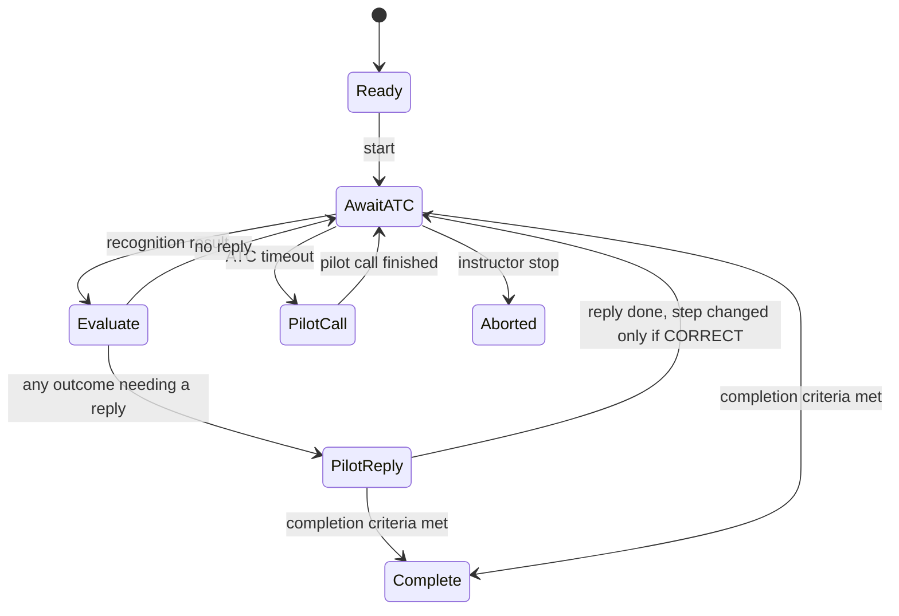

# 03 Scenario, sequence engine, pilot, radio voice, assessment

All procedure text, transitions and safety rules are data. Samples are **PLACEHOLDER – validate against approved SOP**.

## 1. Scenario configuration

Schemas: [`schema/scenario.schema.json`](schema/scenario.schema.json), [`schema/airfield.schema.json`](schema/airfield.schema.json). Samples: `schema/sample-*.json`.

Every text block carries `validation: {status: placeholder|validated, sopRef, validatedBy}`. In assessed mode a scenario with any `placeholder` is refused (P-11).

Two validation passes at load, both with file and path in the error:
1. Schema: shape, types, enums.
2. Semantic: transition targets exist; every step reachable; a completion step reachable; template variables defined; required parameters supplied by a generator or an intent; intents exist in vocabulary; timeouts positive.

### Parameter generation

Seeded RNG; seed stored with the session. Order: airfield → runway → taxiway **serving that runway** → aircraft type **allowed for the category** → callsign matching type. The generator enumerates valid combinations and picks one, so no retry loop and no invalid pair. An empty set is a load error.

## 2. Sequence engine

- Events: recognition, PTT edge, playback done, timer, instructor action, injected unexpected event.
- Transition fires on `(step, outcome, guard)`; guards are simple comparisons over context, not scripts.
- **Only `CORRECT` advances.** Incorrect outcomes are logged and may take a configured *error branch*, which is a distinct, explicit transition.
- Pure function style: `(state, event) → (state', effects)`. Replaying the event log with the seed reproduces the exercise.
- Snapshot to SQLite after each applied event; on restart the exercise resumes at Idle with the pilot reply marked outstanding.

### Validator order

| # | Check | Failing outcome |
|---|---|---|
| 1 | Recognition class UNRECOGNIZED/AMBIGUOUS | UNINTELLIGIBLE / AMBIGUOUS |
| 2 | Callsign missing / different | MISSING_INFO / WRONG_CALLSIGN |
| 3 | Safety rule (configured) | UNSAFE |
| 4 | Conflict with issued clearance | CONFLICT |
| 5 | Required parameter missing | MISSING_INFO |
| 6 | Intent not expected in this step, or a value the step does not list (D-417) | UNEXPECTED |
| 7 | Value invalid or not matching the configured expectation | INCORRECT |
| – | All pass | CORRECT |

Safety precedes order so an unsafe instruction is never reported merely as "unexpected". Safety rules ship **empty**; they come from your documents.

## 3. Pilot behaviour

| Outcome | Default action (configurable) |
|---|---|
| CORRECT | Readback |
| MISSING_INFO | Request the missing item |
| AMBIGUOUS, UNINTELLIGIBLE | "Say again" |
| Clipped (spoke before keying, or released early) | Judged normally (D-422). Exception: speech present at release **and** the final critical value is incomplete or fails its shape rules → PARTIAL → "say again" (logged as UNINTELLIGIBLE, "clipped end" and the field). Always counted under PTT discipline. Setting; strict mode gives "say again" to every clipped transmission |
| CONFLICT | Challenge |
| WRONG_CALLSIGN | No reply (configurable) |
| UNSAFE | Configured safety response |
| UNEXPECTED, INCORRECT | Per scenario |
| Timeout | Pilot calls again, up to `maxCalls`; each missed response is logged with its timing and counts in the response time. Then the instructor chooses continue or end; never auto-advance, so a transition on TIMEOUT is refused (D-424) |

- Templates: `{callsign}`, `{runway}` with spoken-form formatters (`|digits`, `|phonetic`). Unknown variable is a load error, never spoken as blank.
- Optional injected pilot readback errors, for the trainee to catch, are off by default and set per scenario with a seeded probability.
- Repeat limit: after N "say again" in one step, instructor is alerted, so STT failure cannot trap a trainee.
- Reply delay: random 0.5–1.5 s default, starting after the decision and only while the pedal is up.

## 4. Radio voice

Template → clip IDs → PhraseAssembler → RadioAudioProcessor → PulseAudio. Prerecorded voice bank, no runtime TTS (D-27).

| Stage | Default |
|---|---|
| Resample to 16 kHz | |
| Band-pass, 2 high-pass + 2 low-pass biquads | 300–3000 Hz |
| Compressor | 3:1 |
| Soft clip | mild |
| Hiss, gated with the transmission | −40 dBFS |
| Squelch click and tail | 60 ms |
| Intensity | off / light / medium / heavy, default light |

`radio_ab` plays each intensity for listening tests; default is chosen by people on the real headset. Voice bank coverage is checked when a scenario loads; a missing clip rejects the scenario. There is no fallback synthesis (D-27).

## 5. Assessment

| Category | Source | Counted against trainee |
|---|---|---|
| Completion | Engine | Yes |
| Correct / incorrect instructions | Validator | Yes |
| Missed steps | Engine, timeout | Yes |
| Pilot readback errors not corrected | Conversation | Yes |
| Response time (pilot end → key-down) | Timestamps | Yes |
| PTT discipline | 02 §1.6 | Yes |
| STT-suspected errors | Low confidence, noise, device loss | **No**, shown separately |

Weights and pass mark in `scoring.json`, set by the instructor; none are proposed as official. An instructor may reclassify a result at debrief; original and change are both kept.

## 6. Storage (SQLite, WAL)

| Table | Main columns |
|---|---|
| session | id, scenario, scenario_hash, seed, start/end, mode, result, stt_model_id, stt_model_config (locked for the exercise, D-39) |
| ptt_event | session, t_mono, source, edge, reason |
| transmission | session, start, end, wav_path, flags |
| recognition | transmission, stt_model_id, stt_model_config JSON (settings and file hashes), raw, normalised, class, confidence JSON |
| instruction | recognition, intent, fields JSON, outcome, step |
| pilot_tx | session, reply_id, clip_ids JSON (D-427), text, start, end, interrupted |
| engine_event | session, seq, type, payload JSON |
| snapshot | session, seq, state JSON |
| assessment_item | session, category, value, adjusted_by, note, stt_model_id, stt_model_config |

WAV 16 kHz mono is 32 kB/s of keyed time. Retention period and who may access recordings are your policy decision.
