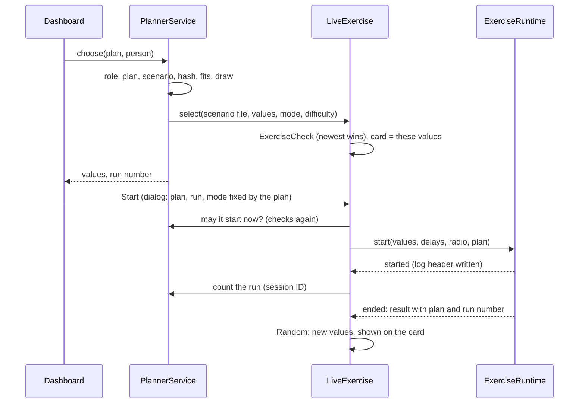

# 10 Exercise Planner: backend (approved 2026-11-26, D-334; PB-6 as D-333)

By b2, night of 2026-11-26. Approved by the user on 2026-11-26 (D-334): PB-1 to PB-5 and PB-7 to PB-9 as recommended; **PB-6: a personal plan is put away when its person logs out; Anyone plans stay.** It is the rest of 08 (sections 2 and 3). Screen: 04 §5g (ui, approved D-143). Interface: ui's `src/app/PlannerBackend.h` (a proposal); answers in section 8. Binding: D-116, D-120, D-127, D-129, D-135, D-141 to D-148, D-318, D-321, D-326, D-327. Already approved by the user: plans store exact values, and the change of engine's contract for it. "Exists" was read in the code, not run. Nothing here is measured. Points for the user: **PB-1 to PB-9** (section 10).

## 1. Parts

| Part | Folder | Qt | Does |
|---|---|---|---|
| `PlanStore` | `src/storage` | no | plans, presets, runs on disk; one file replaced in one step, one append-only file |
| `combinations()`, `fits()` | `src/scenario` | no | all valid value sets; whether one is valid. Today `enumerate` is private to the generator |
| `PlannerService` | `src/app` | no | rules: role, checks, drawing values, choosing. One worker thread, as `StudioService` |
| `LiveExercise` (change) | `src/app` | yes | runs the chosen plan instead of the one scenario of `ui.json` |
| Exact values, difficulty, plan in the log | `src/engine`, `src/runtime`, `src/core` | no | section 4; engine reviews later |

## 2. Files

```
<writable>/planner/plans.json   {format 1, presets[3], plans[...]}       owner only, replaced in one step
<writable>/planner/runs.jsonl   one line for each started exercise with a plan, appended, synced
```

- `revision` is the hash of `plans.json` only; counting a run never changes it.
- A plan: id (random, never reused), name, scenario id, hash (section 3), trainee ID or empty, mode, fixed or random, values, briefing, difficulty with its preset, saved at. No trainee name or rank.
- A run: plan id, **plan name at that time**, person (ID, empty for a guest or the instructor), run number (0 for those), session ID, values, time. Deleting a plan keeps its runs (04 §5g). Run number = runs of this plan and person + 1 (P-7); the plan's count is all its lines.
- A file that cannot be read is reported and never overwritten (as `people.json`). A broken last line of `runs.jsonl` (power cut) is skipped and reported; every other broken line is an error.
- **PB-1:** a run is counted when the exercise has **started** (the log file exists), so a stopped or crashed exercise counts too. Alternative: at the end only.

## 3. When a plan may start

| Check | Where | If not |
|---|---|---|
| The scenario loads | `loadExercise` with the folder in use (D-318) | "Cannot start" with the loader's error |
| The scenario is the one that was planned | hash | "Scenario changed": not startable until the instructor has opened and saved it again |
| Fixed values are a valid combination **now** | `fits()` | "Cannot start: B2 does not serve 09" |
| Voice bank | `ExerciseCheck` (MayUse and words, D-331) | as today |
| Assessed | `modeError` (P-11: no placeholder text), a trainee and not Anyone, that trainee is logged in | refused with the reason; Practice warns only about the person (D-142) |
| Role | saving, deleting and presets: instructor, not during an exercise. Choosing: instructor all; trainee their own and Anyone; guest Anyone | refused |

Checked when the list is shown, when the plan is put on the Dashboard, **and again at Start**: between the two the data can have changed.

**PB-2, the hash.** `Exercise::hash` covers every file that was read, all of `data/phraseology` included. With it, each wording saved in the Studio would mark **every** plan "Scenario changed". Proposed: a plan keeps the hash of the scenario file and of its airfield file. Wording is not part of a plan; the log header keeps `Exercise::hash` as today, so results with other wording are still told apart.

## 4. Contract changes (core, engine, runtime)

1. `ExerciseOptions` gets `values` (optional), `replyDelayMin/Max` (optional) and `plan` {id, name, run, preset, person planned for}.
2. `SequenceEngine` takes the values if they are given, else the seed's, as today. Values that do not fit are refused **by `ExerciseRuntime::start` before the model is locked**, never corrected.
3. The seed stays: takes, reply delays and radio noise come from it.
4. `EventLogHeader` gets `values` (**always written**, also without a plan), `replyDelay`, `radio` and `plan`. Version 2; version 1 logs are still read. Replay uses the header's values; an old log uses the seed (and is right only while the pools are the same).
5. Not built, and shown so: events, and Normal's "say again" (P-8, engine). The header says `events: []`.

This closes the gap found in 3c: the log alone did not say which values an exercise had; they had to be recomputed from the seed.

## 5. Values

- **Fixed:** exactly those of the plan. **Random:** drawn by `choose()`, shown, and those run (D-321). Never exactly the (callsign, runway, taxiway) of that person's previous run; if the pools allow only one, it is used and the screen says so.
- **PB-3:** "previous run" = the person's latest run of **any** plan with the same airfield. For a guest and the instructor there is none.
- For a plan of one person the draw looks at that person's runs, whoever chooses (ui's point).
- **PB-4, Run again:** Random draws new values after the exercise and shows them (D-321); Fixed keeps them.
- The draw is uniform over the allowed combinations (`std::random_device` seed, as today).

Observed: all nine exercises of 2026-11-25 had runway 27. The compiled draw gives equal shares over 40 000 random seeds, so it is not biased; that agrees with chance (about 1 in 500) and does not prove it for those nine. A test of the shares belongs to this package.

## 6. From choosing to the result



- Without a plan everything is as today (the scenario of `ui.json`, values by seed), and the header still has its values.
- **PB-5:** the choice is kept in memory only: after a restart no plan is chosen.
- **PB-6:** while a plan is chosen for a person and somebody else logs in: the plan stays chosen; Start applies the rule (Assessed refused, Practice warns). At log-out of the person it stays. **Consequence (found by ui):** a guest or S02 may not choose a plan of S01, but at a Dashboard where it is still chosen they can start it in Practice after a warning, and the card keeps the ID S01 and the briefing after the log-out. Alternative: a plan of one person is put away at their log-out.
- **Run number and previous run belong to the person at Start**, not at `choose()` (ui): opening the Start dialog takes the person again, shows that person's run number, and for Random draws again if the values are exactly that person's previous combination; the dialog and the card show the new values before Start. The person cannot change while the dialog is open (login is closed there).
- Nothing can be chosen during an exercise, in its Start dialog or in "Complete".

## 7. Rules that are kept in the backend

- A briefing with more than 200 characters, or with a control character, is refused. It goes only to the card; never to the parser, the engine, the model, the prompt or the log.
- Names unique (without regard to upper and lower case), 1 to 40 characters; reply delays 0.3 to 5.0 s in steps of 0.1 s, from not above to; radio one of four (D-146, D-147).
- Presets: edited by the instructor; a saved plan keeps its values (P-6). Starting values D-142.
- Personal data: IDs only, owner-only files, nothing leaves the machine, nothing in git.

## 8. Answers to ui's interface

| Point of ui | Answer |
|---|---|
| `load` for everybody; `revision` over plans and presets | yes |
| `choose(plan, person)` draws, sets the scenario of `StatusFeed`, starts the check | yes; `person` is **not** trusted: the backend asks `AccessController` itself, on the GUI thread **in the call of `choose()`**, never later on the worker; the parameter is dropped |
| `PlanScenario::combinations` | yes. Today 4; an airfield with many values can give thousands: at most 2000 are given, `tooMany` is set, and the screen asks `fits(values)` (new function, answered by a callback with yes/no and the reason, "B2 does not serve 09") instead of filtering a list |
| `PlanScenario::hash` | scenario and airfield file (PB-2) |
| `PlanCoverage` | clips needed, missing; words that differ count as missing (ST-4); `Failed` has a text: add `error` |
| `ExerciseContext::plan` | set by `ExerciseView` from the options that really ran |
| `setEvents(plansChanged)` | yes; also after the Studio saved wording (the checks may differ) |
| Plan of a person whose record is gone | shown, "Cannot start: no record S01" |

## 9. Order of work and tests (one commit each, full build in a free slot)

| Package | Tests |
|---|---|
| P1 exact values | values given are the ones spoken, expected and logged; values that do not fit refused before the lock; version 1 log replays; every combination of the sample airfield; the compiled draw: all combinations come, equal shares within statistics |
| P2 `PlanStore` | one-step replace, refused after a change on disk, broken file never overwritten, broken last run line, run numbers per plan and person, guest unnumbered but counted, deletion keeps runs |
| P3 `PlannerService` | every row of section 3 with a positive control; previous combination avoided, only-one case; briefing and name rules |
| P4 `LiveExercise` | card = dialog = header = engine for fixed, random, Run again; checked again at Start; not during an exercise; without a plan as today |
| P5 ui's screens on the real backend | on fakes; then the user on the panel |

Resource use (estimate, **to be measured on the panel**): two small files, one thread that sleeps; reading a plan list loads each scenario once (today one file).

## 10. The user decides

| # | Question | Recommended |
|---|---|---|
| PB-1 | A run counts from its start (also if stopped) | yes |
| PB-2 | "Scenario changed" looks at the scenario and airfield files, not at wording | yes |
| PB-3 | "Previous run" is the person's latest run of any plan with the same airfield | yes |
| PB-4 | Run again of a Random plan: new values, shown first; of a Fixed plan: the same | yes |
| PB-5 | The chosen plan is forgotten at program end | yes |
| PB-6 | A chosen plan stays chosen at log-in and log-out; Start applies the person rule. Consequence: somebody else, also a guest, can start S01's plan in Practice after a warning, and the card shows S01 and the briefing after log-out | your choice; b2 recommends to put a **personal** plan away at that person's log-out, and to keep Anyone plans |
| PB-7 | Header version 2 with exact values in **every** exercise, also without a plan | yes |
| PB-8 | b2 makes the changes in engine's files (section 4) before engine resumes, minimal, listed for engine's review (as 3c) | yes |
| PB-9 | Results and history by plan (5e) come with 5e, not here; until then only the count and last date are shown | yes |
